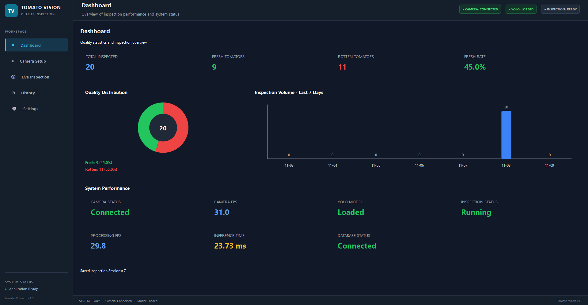
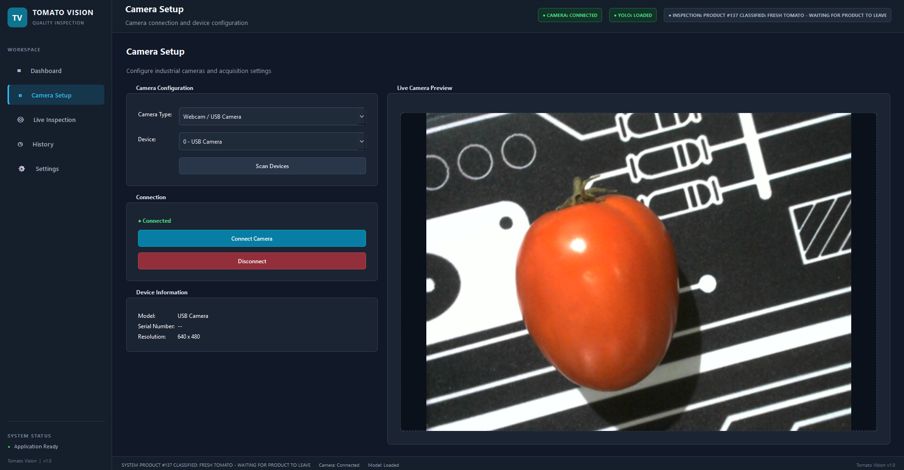
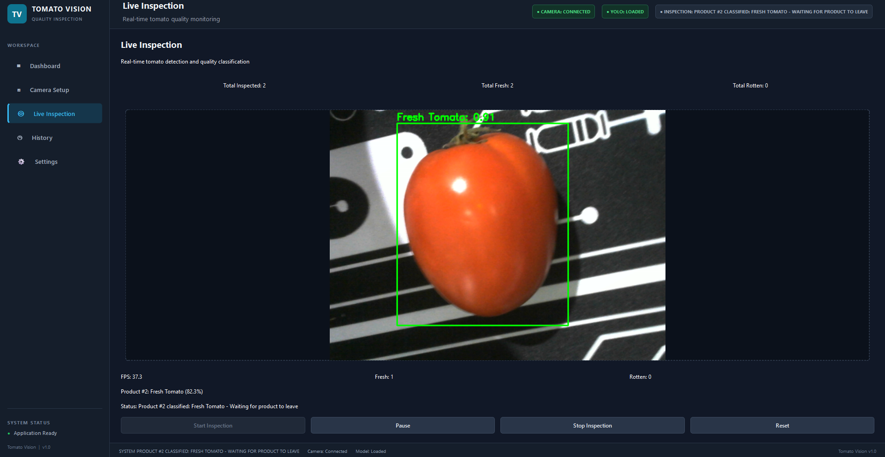
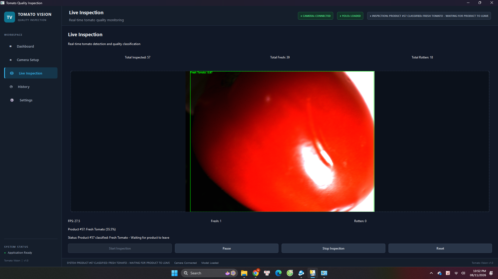
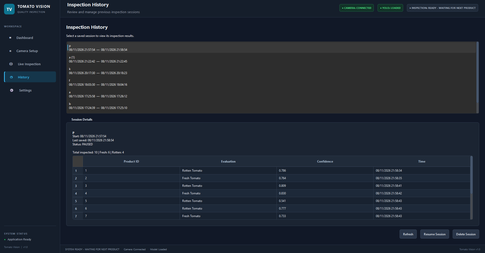
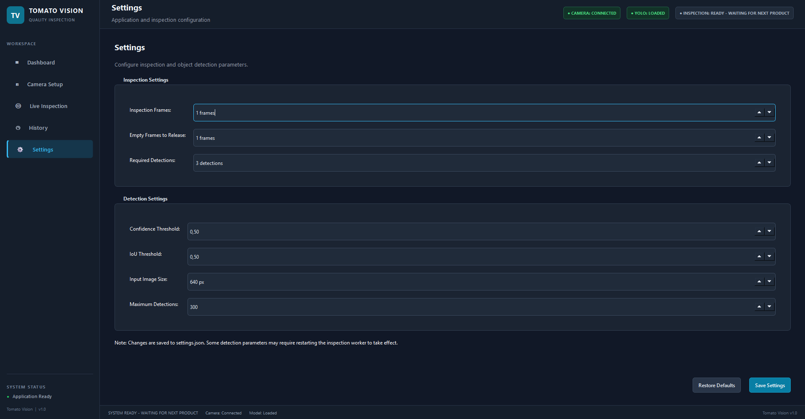

# 🍅 Tomato Quality Inspection System

An AI-powered desktop application for automated tomato quality
inspection using Deep Learning and industrial machine vision.

The system combines a custom-trained YOLO26n object detection model,
ONNX Runtime inference, and industrial camera integration to detect and
classify fresh and rotten tomatoes in real time.

------------------------------------------------------------------------

## 1. Project Overview

This project demonstrates an end-to-end Computer Vision workflow, from
dataset preparation and model training to model optimization, industrial
camera integration, and desktop application development.

The application detects tomatoes in camera frames and classifies them
into two quality categories:

   Class  Label            Class ID
  ------- --------------- ----------
    🍅    Fresh Tomato        0
    🍂    Rotten Tomato       1

The desktop application provides live inspection, detection
visualization, inspection statistics, and inspection history.

## 2. Key Features

### AI-Based Tomato Detection

-   Custom-trained YOLO26n object detection model.
-   Detection and classification of fresh and rotten tomatoes.
-   Bounding-box visualization with class labels and confidence scores.

### Real-Time Camera Integration

-   Hikrobot industrial camera support through the MVS SDK.
-   USB webcam support through OpenCV.
-   Live camera streaming and real-time inference.
-   Asynchronous camera acquisition and processing.

### Desktop Application

-   Dark-themed graphical user interface built with PySide6.
-   Dashboard for inspection statistics.
-   Camera setup and device configuration.
-   Live inspection with real-time detection visualization.
-   Inspection history and session management.

### Model Deployment

-   Export from PyTorch to ONNX format.
-   GPU-accelerated inference with ONNX Runtime CUDA Execution Provider.
-   CPU execution fallback where supported.
-   Performance benchmarking for inference latency and processing
    throughput.

## 3. System Architecture

``` text
       Hikrobot Industrial Camera / USB Camera
                         |
                         v
                 Camera Acquisition
                         |
                         v
                  Frame Processing
                         |
                         v
                  YOLO26n ONNX
                         |
                         v
               Detection Post-processing
                         |
                         v
                Inspection Management
                    /          \
                   v            v
          Live Visualization  Result Storage
                   |            |
                   v            v
              PySide6 UI     SQLite Database
                   |
                   v
          Dashboard / Live / History
```

## 4. Dataset Preparation

A custom object detection dataset was prepared for two tomato quality
classes.

Dataset preparation included: - Organizing images and YOLO-format
annotations. - Checking image-label consistency. - Identifying and
removing invalid or missing-label samples. - Preparing training,
validation, and test splits.

### Dataset Classes

   Class  Label            Class ID
  ------- --------------- ----------
    🍅    Fresh Tomato        0
    🍂    Rotten Tomato       1

## 5. Model Training and Evaluation

The YOLO26n model was selected to balance detection accuracy and
computational efficiency for real-time deployment.

### Training Configuration

  Parameter             Value
  ------------------ ------------
  Model                YOLO26n
  Input Image Size    640 × 640
  Epochs                 100
  Batch Size              32
  Training Device     NVIDIA GPU

### Test Dataset Results

The trained model was evaluated on an independent test dataset.

  Metric        Result
  ----------- --------
  Precision     92.17%
  Recall        95.77%
  mAP@50        96.95%
  mAP@50-95     95.01%

## 6. ONNX Deployment and Performance

The trained PyTorch model was exported to ONNX format and integrated
into the application using ONNX Runtime.

``` text
YOLO26n (PyTorch)
       |
       v
    ONNX Export
       |
       v
    best.onnx
       |
       v
  ONNX Runtime
       |
       v
 CUDA / CPU Execution
       |
       v
 Real-Time Detection
```

### Real-Time Performance Benchmark

The integrated application was tested with a Hikrobot industrial camera
during a one-hour continuous operation test.

  Metric                               Result
  -------------------------- ----------------
  Processing Throughput             27.94 FPS
  Inference Latency            23.92 ms/frame
  Continuous Test Duration             1 hour
  Inference Engine               ONNX Runtime

**Note:** Processing throughput and inference latency are different
measurements. Throughput represents the number of frames processed per
second, while inference latency measures the time required for an
individual model inference. The two values should not be expected to be
exact reciprocals because they may be measured at different stages of
the pipeline.

## 7. Application Interface


### Dashboard



### Camera Setup




### Live Inspection

Live inspection on webcam


Live inspection on hikrobot camera


### Inspection History



### Settings



## 8. Project Structure

The following is a representative project structure.

``` text
tomatoes-quality-classification/
├── app/
│   ├── camera_setup/       # Camera integration and camera libraries
│   ├── config/             # Application configuration
│   ├── core/               # Application-level core components
│   ├── data/               # Application data resources
│   ├── database/           # Database operations and storage
│   ├── inspection/         # Inspection workflow and logic
│   ├── services/           # Application services
│   ├── ui/                 # Desktop user interface
│   └── main.py             # Application package entry point
├── model/                  # Model files, including the deployed ONNX model
├── scripts/                # Supporting and utility scripts
├── test_images/            # Images used for testing
├── .gitignore
├── LICENSE
├── README.md
├── main.py                 # Project entry point
├── requirements.txt        # Python dependencies
├── samples.py              # Sample/demo script
├── test.py                 # Testing script
└── train.py                # Model training script
```

## 9. Installation

### Prerequisites

-   Python version compatible with the packages in `requirements.txt`.
-   NVIDIA GPU and compatible drivers for CUDA-accelerated inference
    (optional).
-   Hikrobot MVS SDK for Hikrobot industrial camera support. Visit the official [Hikrobot Download Center](https://www.hikrobotics.com/en/machinevision/service/download).

**How to Install MVS**
``` bash
Run the downloaded installer as Administrator  -> Accept the license agreement -> Follow the installation wizard -> Make sure the GigE camera driver is selected during installation 
-> This is required for GigE Vision cameras such as the Hikrobot MV-CE200GC -> Connect the Hikrobot camera to your computer using an Ethernet cable.
```

-   USB webcam for webcam-based testing (optional).

### Clone the Repository

``` bash
git clone https://github.com/nguyenvietdungk66/tomatoes-quality-classification.git
cd tomatoes-quality-classification
```

### Create and Activate a Virtual Environment

**Windows (PowerShell):**

``` powershell
python -m venv .venv
.venv\\Scripts\\Activate.ps1
```

**Linux:**

``` bash
python3 -m venv .venv
source .venv/bin/activate
```

### Install Dependencies

``` bash
python -m pip install --upgrade pip
pip install -r requirements.txt
```

For Hikrobot cameras, install the MVS SDK separately and ensure its
required runtime libraries and drivers are available to the application.

## 10. Running the Application

Run the application using the entry point provided in the repository.
For example, if the project entry point is `app/main.py`:

``` bash
python app/main.py
```

If your repository uses a different entry point, replace the command
with the appropriate one.

After launching the application:

1.  Open **Camera Setup**.
2.  Select Hikrobot or USB camera.
3.  Scan for available devices and connect to a camera.
4.  Navigate to **Live Inspection**.
5.  Start the inspection process.
6.  Review detection results and inspection statistics.
7.  Open **History** to review recorded inspection sessions.
8.  Open **Settings** to configure the inspection parameters.

## 11. Technology Stack

  Component              Technology
  ---------------------- -------------------------------
  Programming Language   Python
  Deep Learning          PyTorch, Ultralytics YOLO26
  Model Deployment       ONNX, ONNX Runtime
  Computer Vision        OpenCV
  GUI Framework          PySide6 / Qt
  Industrial Camera      Hikrobot MVS SDK
  Database               SQLite
  Multithreading         QThread, Qt Signals and Slots
